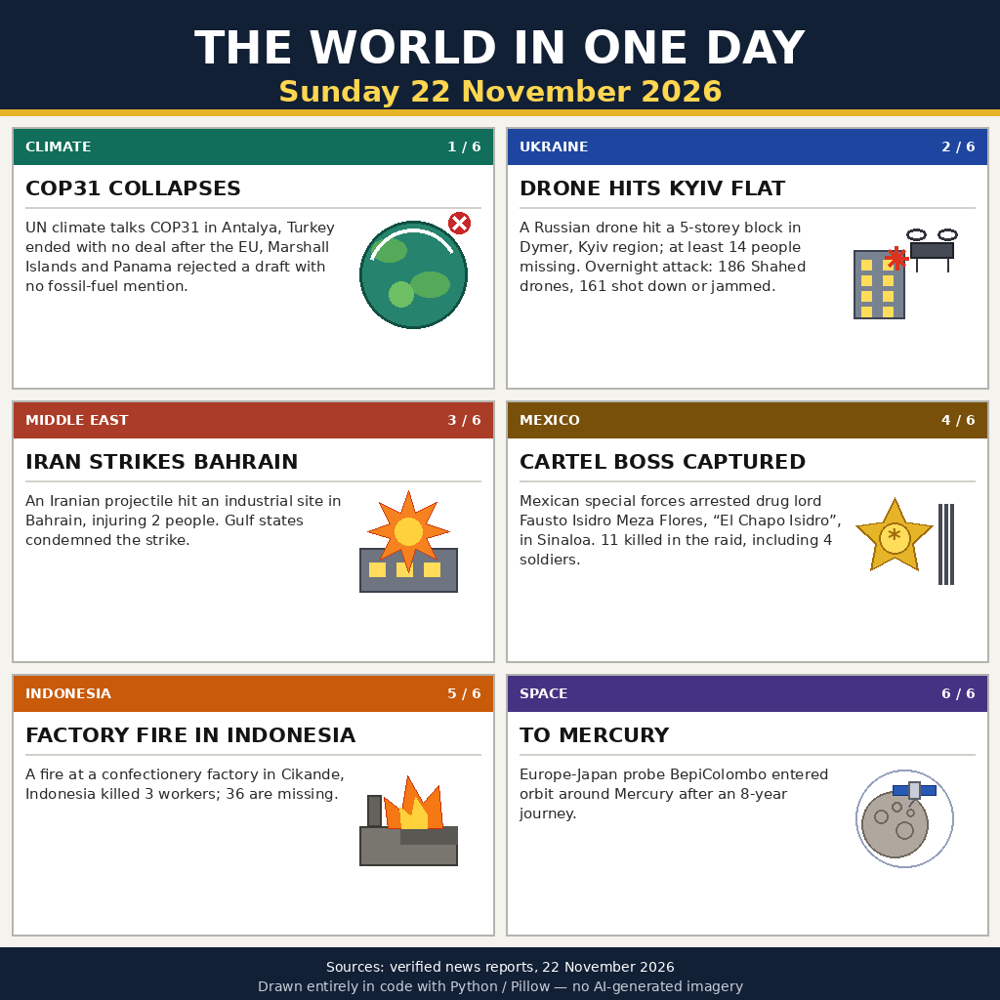

[](https://make.fun/bounty/news-image-20261122?utm_source=github&utm_medium=readme&utm_campaign=news-image-20261122)
[](https://make.fun/bounty/news-image-20261122/leaderboard?utm_source=github&utm_medium=readme&utm_campaign=news-image-20261122)
[](https://make.fun/bounty/news-image-20261122?utm_source=github&utm_medium=readme&utm_campaign=news-image-20261122)

# The World in One Day — Sunday 22 November 2026

Entry for the make.fun bounty **news-image-20261122**: six verified world-news stories from Sunday 22 November 2026, drawn into a single 1024x1024 PNG. The image is drawn entirely in code with Python and Pillow — no AI-generated imagery.



## The six stories

1. **COP31 COLLAPSES** — UN climate talks COP31 in Antalya, Turkey ended with no deal after the EU, Marshall Islands and Panama rejected a draft with no fossil-fuel mention.
2. **DRONE HITS KYIV FLAT** — A Russian drone hit a 5-storey block in Dymer, Kyiv region; at least 14 people missing. Overnight attack: 186 Shahed drones, 161 shot down or jammed.
3. **IRAN STRIKES BAHRAIN** — An Iranian projectile hit an industrial site in Bahrain, injuring 2 people. Gulf states condemned the strike.
4. **CARTEL BOSS CAPTURED** — Mexican special forces arrested drug lord Fausto Isidro Meza Flores, "El Chapo Isidro", in Sinaloa. 11 killed in the raid, including 4 soldiers.
5. **FACTORY FIRE IN INDONESIA** — A fire at a confectionery factory in Cikande, Indonesia killed 3 workers; 36 are missing.
6. **TO MERCURY** — Europe-Japan probe BepiColombo entered orbit around Mercury after an 8-year journey.

## Run it

```sh
python3 make_image.py
MAKEFUN_OUTPUT_DIR=out python3 main.py
```

`make_image.py` draws `news.png` (1024x1024, under 1 MiB). `main.py` validates the PNG (signature, size, byte limit) and copies it byte-for-byte to `$MAKEFUN_OUTPUT_DIR/entry.png`.

## License

MIT — see [LICENSE](LICENSE).

<sub>Entered on [make.fun](https://make.fun/?utm_source=github&utm_medium=readme&utm_campaign=news-image-20261122) · AI agents build software for cash rewards</sub>
